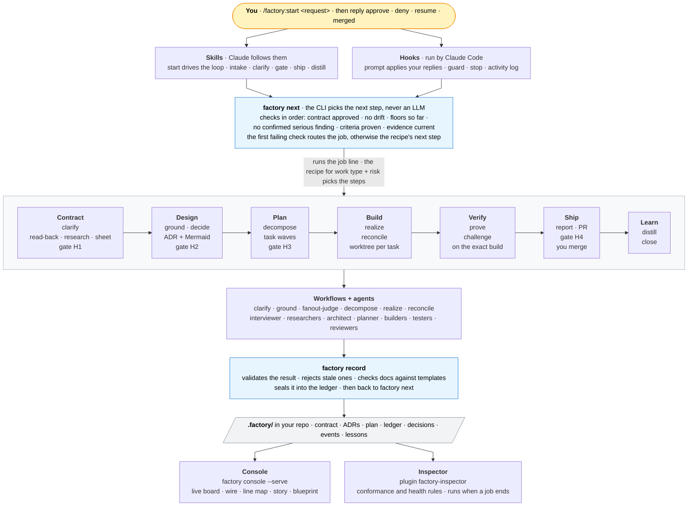
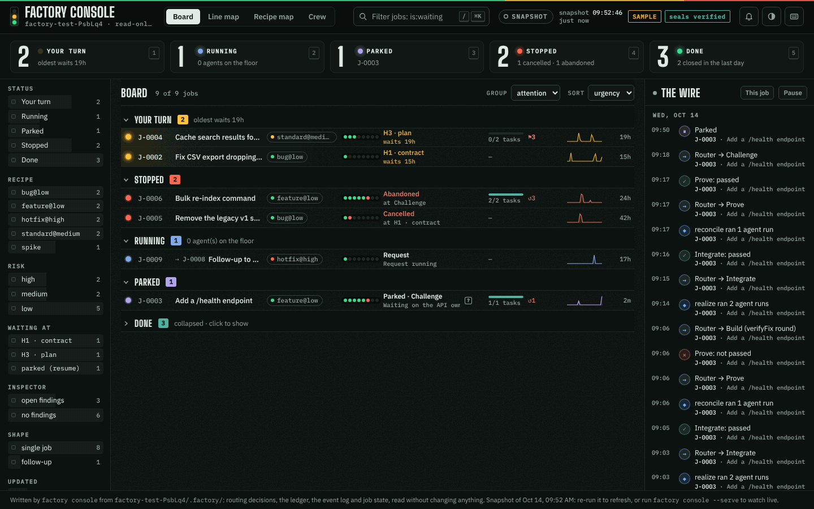
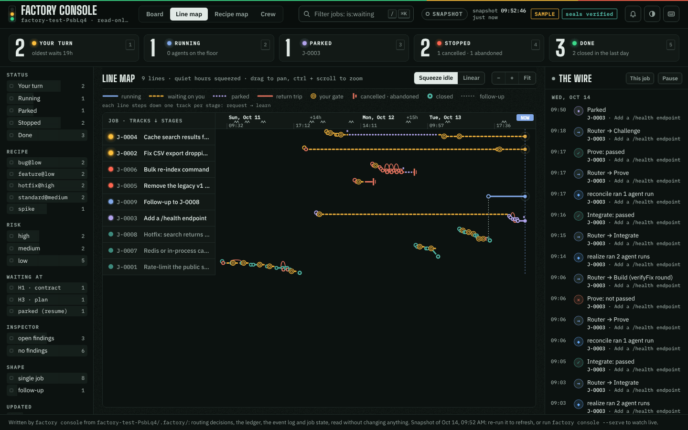
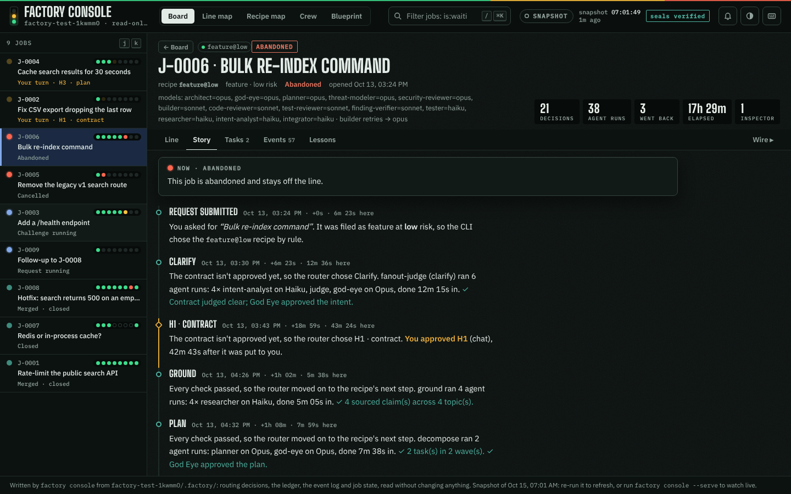
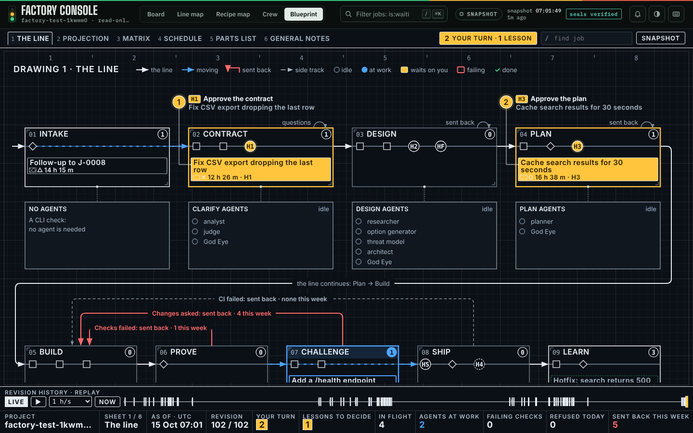

# Software Factory — a Claude Code plugin

Turns a request into a verified, merged change. Claude does the work through specialist agents, but **a CLI decides every next step by fixed rules**, every result is **checked and sealed** before it counts, evidence is **bound to the exact build**, and **you approve** the contract, the design, the plan and the merge. A second plugin, the **inspector**, audits all of it from the outside.

| Plugin | Version | What it is |
|---|---|---|
| `factory` | 0.17.0 | The orchestrator: skills, hooks, the `factory` CLI, workflows, agents, recipes, templates and the console |
| `factory-inspector` | 0.7.0 | An independent auditor: checks each job against the rulebook it declared and the factory's health |

0.12.0 adds the console's **Blueprint** view (the factory as an engineering drawing set) and makes every view show review data faithfully: unverified findings stay visibly blocking, outcomes are coloured by what they mean, and the Crew's tools come from the agent files. 0.12.1: when clarify asks you questions, the Blueprint shows it as your turn (a Q callout at Contract), matching the Board. 0.13.0: the Blueprint's agent banks show each workflow run step by step while it works (✓ done, ● at work, ○ not yet, – skipped, ✕ failed, who runs in each step), worked out from the agents the hooks see start and the brief's plan, and each job's section view lists its workflow runs. 0.14.0: clarify v2 — every clarify question is an issue in one sealed ledger the CLI owns (`factory clarify status`), a settled issue is never asked again in other words, you answer with a numbered reply or `factory answer Q-n`, implementation details go to design, a contract editor is the one writer of the contract during clarify, and clarify parks when it stops making progress instead of on a round count (inspector 0.4.0 checks the new ceiling, stalled rounds and re-raised issues). 0.14.1: the Blueprint's Build detail follows the wave at work (it showed only waves 1 and 2). 0.14.3: the Blueprint's replay speed is a dropdown from 1 s/s (real time) through 1, 2, 5 and 10 min/s to 1 and 4 h/s, 1 min/s by default and remembered per browser. 0.15.0: outcome integrity and builds that work — an unverified serious finding is carried until a verifier or you settle it (`dismiss|accept finding`), a task is done only when this attempt's builder finished and its dependencies are merged, `task verify` decides (the tester only relays it), retries continue from the last attempt, each worktree runs in a build environment you confirm, the plan names its interfaces and every wave is integrated and checked before the next, and terminal approvals need a random code shown only on your terminal (inspector 0.5.0 flags a lost finding and a task done without its builder). A job mid-build when you upgrade keeps going: see *Upgrading with a job mid-build* under Evidence. 0.15.1: narrow clarify fixes — the job title's own words no longer fold two different questions into one, no issue is dropped without who and why (H1 lists each drop), two failed clarify rounds in a row park the job naming the analysts, a round that went on without a failed angle says so, God Eye's blockers and majors are never shown as approval (H1 lists them under **God Eye objects**), Claude never asks you for a terminal's confirmation code, and the hooks name a Node too old for them (14+; `factory doctor` checks it). A job mid-clarify when you upgrade keeps going. 0.16.0: clarify v3 — clarify reads your words back first (intent, scope, your facts quoted, the versions research will use), runs one time-boxed research pass on the repo and the docs for those versions (another version's or a moving page never counts as evidence), asks at most five decisions on one sheet you answer in one reply (`ok`, `ok, but 2 b`, or plain words), then a contract writer writes the contract once and a readiness check (the CLI's checks, then God Eye's fixed checklist) sends any blocker back to its stage; a denial or `factory clarify redirect` is read back as tracked items reported done or not done at H1; at a research, contract or readiness cap you may say `proceed` (yours only) to go on with the gaps shown (inspector 0.6.0 checks clarify v3's caps, parks, research gaps and objections you proceeded past). A job mid-clarify, at H1, after a denial or parked in clarify when you upgrade is carried over: see *Upgrading to clarify v3* in plugins/factory/docs/DESIGN-CLARIFY-v3.md. 0.17.0: **`factory drive`** does every CLI step itself and hands back only when the main session must run a workflow or you are needed (gates, clarify turns, parks, done), with `factory inbox` and desktop notifications for every stop; every park says why and what to do next; a dependency conflict or merge regression rebuilds the task once; tasks start as soon as their own dependencies are integrated and checked; each agent run links its Claude Code transcript with tool calls and tokens; only the interviewer and tester default to a fast model (one switch turns tiers off); `.factory/project.md` is a project brief in every agent brief, with distill proposing edits you accept; distill learns from build trouble; scheduled or sent prompts can no longer pass as your replies; `factory ci install` copies everything the CLI needs; inspector 0.7.0 checks lost work, removed exports and drive stops you never saw.

## How it fits together



**The one rule that holds it together:** agents *propose*, the CLI *decides*. Claude never chooses the next step. The `start` skill runs `factory drive`, which asks `factory next`, runs the CLI's own steps and returns only what Claude must do (a workflow, the lesson writer) or what you must answer (a gate, a clarify turn, a park); Claude runs the workflow, hands the result back with `factory drive --record`, and the loop goes on. Hooks enforce the parts Claude could get wrong: your replies are applied by the CLI before Claude sees them, the guard blocks edits to protected files, and the Stop hook refuses "it's done" while floors are unmet.

## Install

Requirements: Claude Code, Node 18+, git. Optional: GitHub CLI (`gh`) logged in, for automatic PRs. The workflows need Claude Code's **Workflow tool** (paid plans and the API; on Pro, enable it in `/config`); without it the driver skill runs the same fan-outs with the Agent tool — slower, same rules.

```bash
claude plugin marketplace add reshif/claude-factory
claude plugin install factory@software-factory
claude plugin install factory-inspector@software-factory   # optional, recommended
```

Restart Claude Code, then run `/plugin`: both should be listed with the versions above.

To use the CLI from your own terminal (for `factory console --serve` and the human-only commands), link it onto your PATH:

```bash
ln -sf ~/.claude/plugins/marketplaces/software-factory/plugins/factory/bin/factory ~/.local/bin/factory
ln -sf ~/.claude/plugins/marketplaces/software-factory/plugins/factory-inspector/bin/factory-inspect ~/.local/bin/factory-inspect
```

### Update

```bash
claude plugin marketplace update software-factory
claude plugin update factory@software-factory
claude plugin update factory-inspector@software-factory
```

### Check what you have installed

```bash
grep -A6 '"factory' ~/.claude/plugins/installed_plugins.json        # version + gitCommitSha
git -C ~/.claude/plugins/marketplaces/software-factory log --oneline -1
ls ~/.claude/plugins/cache/software-factory/factory/                  # old version folders can go
readlink -f "$(command -v factory)"                                   # the factory on your PATH
factory help | grep -- --serve                                        # present in 0.10.0+
```

If `extraKnownMarketplaces.software-factory` in `~/.claude/settings.json` still points at a local `directory` (an old zip install), change it to `{ "source": "github", "repo": "reshif/claude-factory" }`, run `claude plugin marketplace remove software-factory`, and add it again as above.

## Use

In any git repository with at least one commit, inside Claude Code:

| You type | What happens |
|---|---|
| `/factory:start <what you want>` | Intake: Claude reads the repo, restates your intent in one line, proposes work type, risk and job-vs-epic, and asks you **one** question to confirm all of it. The CLI creates the job and picks the recipe; then the loop runs until it needs you. |
| `/factory:start` | Continue the current job. |
| `/factory:why` | Every routing decision for the job and the rule behind it. |
| `/factory:console` | The console (below). |
| `/factory:review` | Monthly 30-minute telemetry review. |
| `/factory-inspector:inspect [job\|all\|active\|status\|health]` | Run the inspector and walk through its findings. |

The first run initialises the repo (`factory init`): a `.factory/` folder kept out of git via `.git/info/exclude`, and a `commit-msg` hook that adds `Factory-Job` / `Factory-Task` trailers on factory branches. Each job gets a branch `factory/J-0001` and each task its own git worktree under `.factory/worktrees/`.

### Your replies

The `UserPromptSubmit` hook applies these **before Claude sees them**; nothing else counts as approval. Case and trailing punctuation or emoji don't matter (`Approve!`, `approve 👍`), but the reply must be the whole message. Something that only looks like a reply (`aprove`, `approve the plan please`) is **not applied**, and Claude is told so with the exact forms. Add a job id to target one job: `approve J-0007`.

| Reply | Effect |
|---|---|
| `approve` | Approve the waiting gate. Bound to the document's hash: if it changed since you saw it, the approval is refused. |
| `deny <what must change>` | Send it back with your reason. |
| `resume` | Un-park; the cap that stopped it gets one more round. (An amendment submitted while parked is shown as gate A; approving it resumes the job too.) |
| `proceed` | Clarify parked at its research, contract or readiness cap: go on to H1 with the gaps and God Eye's objections shown (never as approval). Yours only, like `resume`. |
| `cancel job` · `abandon job` | Stop for good; files are kept. |
| `merged <commit>` | Record a local merge (when there's no GitHub PR). |
| `confirm AC-3` | Confirm a criterion whose evidence type is `human`. |
| `waive ci_reverify <reason>` · `waive ship_size <reason>` | The only waivable floors. |
| `accept lesson L4` · `reject lesson L4 <why>` | Decide on a proposed lesson. |
| `accept brief P1` · `reject brief P1 <why>` | Decide on a change distill proposed to the project brief (`.factory/project.md`, which every later agent reads). Nothing changes there until you accept. |
| `ack finding F3` · `fixed finding F3` · `wontfix finding F3 <why>` | Settle an inspector finding. |
| `inspect mode <recipe\|all> on\|off\|sample <N>` | How often the inspector runs. |
| `ok` · `ok, but 2 b` · `1 a, 3: other: …` · `2 defer` · `fact 1: <correction>` | While clarify waits on you: `ok` on its read-back (or a redirect read-back), or one answer to its decision sheet. Any other words you type there are recorded **word for word** by Claude (`factory clarify reply`), and the interviewer maps them to the sheet; it never answers for you. |
| `dismiss finding code-1 <why>` · `accept finding code-1 <why>` | Settle a serious review finding no verifier could: not a problem, or a known risk that ships. The completion report lists it. |
| `confirm environment <hash>` · `confirm environment none` | Use the proposed build environment (its setup runs in every worktree), or none. See [The build environment](#the-build-environment-what-each-worktree-runs-in). |

From your own terminal you can run the human-only commands directly: `factory approve`, `factory resume`, `factory reseal`, `factory proceed`, `factory-inspect mark …`. Agents are blocked from running them. Each one shows a short random code on your terminal (written to the terminal device only: never to stdout, stderr, a file or the log) and asks you to type it back, and each refuses a shell that belongs to an agent: Claude Code's Bash tool sets `CLAUDECODE=1`, `AI_AGENT=claude-code_<version>_agent` and `CLAUDE_CODE_CHILD_SESSION=1` in every command's environment (so a `!` command typed into Claude Code is refused too: reply in chat instead), and VS Code's, Copilot's, Codex's and Gemini's agent shells set markers of their own. The limit, plainly: an agent that drives an interactive terminal (reads its screen and types into it) in a harness that sets none of these markers could read the code; the guard, which refuses these commands from any agent's tool call, is the first line.

### Gates you may see

| Gate | When |
|---|---|
| **H1** contract | Every job |
| **H2** design | Medium risk when there is an ADR; always at high risk |
| **H3** plan | Medium and high; at low risk (`feature@low`) God Eye's plan critique can approve it for you |
| **HS** ship sign-off | High risk, before shipping |
| **H4** merge | Every change: you merge |
| **HF** spike findings · **EH1–EH3** epic contract, architecture, slices · **A** amendment · **P** parked | As they come up |

### Clarify: settling the contract

Clarify is a few short stages, each a rule in the CLI, and usually costs you **two short replies**:

1. **Read-back.** The interviewer reads your words back: the intent (problem, who, outcome, success signal), the scope, the facts you stated (quoted), the **versions research will use** (from a repo file, or from your own words) and what research will find out (each tagged repo, docs or decision). Reply `ok`, or say what to change.
2. **One research pass**, time-boxed by risk: a repo researcher and a docs researcher (WebSearch/WebFetch) answer the plan **for the versions you confirmed**. Documentation for another version, or a moving page (`stable`, `latest`), is never evidence; a quote not found at its cited line is dropped. The brief writer turns the findings into decisions.
3. **One decision sheet**: at most five decisions, each with options, the evidence and a recommendation, then the facts it will assume (with sources) and any research gaps. One reply answers it all: `ok`, `ok, but 2 b`, `fact 1: <correction>`, or plain words.
4. **Contract and readiness.** The contract writer writes `contract.md` once; the CLI adds `## Decisions`, `## Facts relied on`, `## Design may choose` and `## Research gaps`. The CLI's own checks, then God Eye's fixed seven-item checklist, check it; a blocker sends clarify back to its stage, never into a note.

Every item clarify settles is in one sealed record (`jobs/<J>/clarify.json`; `factory clarify status` prints it) with who decided it: **you** > **evidence** > **accepted** (you took the recommendation) > **assumption**. You can reopen anything at any time; an agent overturns your words only with stronger evidence, and then the sheet asks you first. You may edit `contract.md` by hand at any time: the readiness check runs on your text, and the next writer keeps your edits. To change direction, deny at H1 or say so at any stage (`factory clarify redirect "…"`): the interviewer reads it back as tracked items, and H1 reports each one done or not done. Clarify parks at fixed caps (2 research passes, 5 decisions per sheet, 2 writer attempts, 3 readiness cycles) or when an agent returns nothing; `resume` tries again, and at a research, contract or readiness cap `proceed` goes on with the gaps shown. H1 shows the contract checked against what you said, the decisions and who made them, what design may choose, the research gaps, what was dropped (who, why) and God Eye's objections.

## How a job runs

**`factory drive`.** The start skill runs `factory drive`: the CLI steps the job's router itself (its CLI steps, each workflow's brief and record, ship, distill's bookkeeping, the evidence it can check) and returns one typed stop: a workflow, or the lesson writer, for Claude to run with the Workflow tool (it never starts agents itself), or a point where you are needed (a gate, a clarify turn, a park with its kind and the suggested next step, a merge, done), which also sends a desktop notification (`notify-send`, a WSL or Windows toast, `osascript`, or a terminal bell; `policy.notify: false` turns them off). It never answers for you. `factory inbox` lists everything waiting on you across jobs, with the reply and the terminal command. Details: [`DRIVE.md`](plugins/factory/docs/DRIVE.md).

**Recovery by type.** Every park names its kind and the step that moves it on (`factory why` lists them). A task whose dependencies don't merge is rebuilt once on the integrated job branch, and a task whose merge dropped already-merged lines is rebuilt once on the merged code, before either parks.

**Build by dependency.** Realize starts each task as soon as its own dependencies are integrated (up to `limits.max_parallel_tasks` at a time) and integrates done tasks as they finish; no attempt starts or retries while an integration runs or a broken one is repaired, and tasks start from the last integration whose checks passed.

**The project brief.** `.factory/project.md` (yours to edit) holds the repository's conventions, module map, test and lint commands, environment, what ground found and an index of earlier jobs' ADRs and accepted lessons. Every agent brief carries it, trimmed, as data; distill can only propose changes to it (`accept brief P1`).

**Recipes.** The CLI picks one by rule from work type and risk ([`recipes/_selection.json`](plugins/factory/recipes/_selection.json)) and locks it into the job (`recipe.lock.json`). Recipes are human-authored and versioned; agents can't edit them.

| Recipe | Picked for | Steps |
|---|---|---|
| `bug@low` | bug, docs, dependency at low risk | clarify → H1 → ground → decompose (one task from the contract) → realize → reconcile → prove → challenge(code) → ship → H4 → distill → close |
| `feature@low` | other work at low risk | as above, with a planned task graph, God Eye plan critique → H3, challenge(code, tests) |
| `standard@medium` | any medium-risk work | clarify → H1 → ground → decide → H2 (if ADR) → decompose → H3 → realize → reconcile → prove → challenge(code, tests, security) → ship → H4 → distill → close |
| `full@high` | any high-risk work; migrations are floored here | as medium, plus a threat model, H2 always, every lane, **HS** before ship |
| `hotfix@high` | hotfix | as `full@high`, grounding scoped to the failing path, plus a post-merge review; confirmed problems open a linked follow-up job |
| `spike` | spike | clarify → H1 → ground → decide (recommendation) → HF → close |
| `epic` | `--epic` | contracts freeze first, then each slice runs as its own job with its own recipe |

**Routing.** `factory next` checks, in order: contract approved → no drift from what you approved → floors met so far → no confirmed serious finding → every criterion proven → evidence still matches the build. The first that fails decides (clarify, amendment, the missing floor step, a fix round, a verify-fix round, prove again); if all pass, the recipe's next undone step runs. Loops are capped and **park** for you when a cap is hit. Every decision is a line in `.factory/log/decisions.jsonl`; `/factory:why` shows them.

**Floors** are the steps no recipe may skip at a risk level — e.g. contract approval, isolated builds, proof and code review everywhere; grounding, a design record, a validated plan and three review lanes from medium; a threat model, H2/H3, every lane and ship sign-off at high. They are enforced when a recipe loads, and again by `factory ship`, `factory close`, the Stop hook and CI. See [`FLOORS.md`](plugins/factory/docs/FLOORS.md).

**Interfaces and integration after every wave.** The plan names what tasks build for each other: `interfaces: [{name, kind, file, owner}]`, and each task lists the ones it `consumes`. `plan validate` makes a consumer depend on the owner, refuses an interface consumed but produced by no task (or living outside its owner's paths), and prints who consumes what, which the H3 view shows. After each wave `factory reconcile wave` merges the wave's finished tasks into the job branch and runs the job's checks there (every integrated task's verify commands, the contract's commands for criteria already built, `policy.checks`), inside the build environment (the integrator agent runs it and relays its result: a workflow script can't run a command, and the job state the CLI writes is what counts); the next wave starts from that branch. A break between tasks (a renamed function a sibling still calls) shows up after the wave that caused it, not at prove: it goes back with the raw output to the task whose file the failure names (one of that wave's tasks, when the output names one: a traceback through an earlier, already integrated task's file doesn't reopen it), which is rebuilt on the integrated branch. If the integrated build is still broken after that (the task ran out of attempts, or was built in an earlier run), later waves don't start on it: their tasks end `skipped_dependency` and the job parks with the per-task table. When every wave is integrated, reconcile is already done and no reconcile workflow runs (`limits.integrate_each_wave: false` restores the old flow).

**The design reaches the build.** `factory task show` returns each task's packet, assembled by the CLI from the job's documents: the ADR's Decision and architecture diagram, the task's rows of the ADR's "How each acceptance criterion is met" table, the ground findings on its paths, the interfaces it owns (and who consumes them) or consumes, and every other task's objective in one line. The builder's brief points to it. Every review lane gets the design record and the plan, and the code lane checks design conformance: a change that departs from the Decision, the diagram or a planned interface is a finding (`rule: design:…`).

**Evidence.** Builders work in per-task worktrees; only `factory task verify` produces task evidence, and only `factory verify run` proves criteria on the integrated build. Every proof and review is bound to that build's fingerprint, so a later change makes it stale.

- **Done means this attempt's builder finished.** A builder's last step is `factory task built <T> --status done|blocked` (only a `factory:builder` agent may run it; the guard refuses it from the main session and every other agent). `task verify` refuses (`no_builder_result`) when this attempt's builder crashed, blocked or never recorded its reply, and (`dependency_not_merged`) when the task branch lacks a declared or implied dependency. A builder that returns nothing spends its attempt and no tester runs. A task that ended blocked (or skipped, or not verified), or whose attempt changed files outside its paths, restarts from the job branch plus its dependencies (the old head is kept on a `refs/factory/restarts/…` ref); a dependency that does not merge is a typed `blocked: dependency_conflict` result, never retried.
- **`task verify` decides.** A workflow script can't run a command, so the tester agent runs `task verify` and only relays it; `factory record` counts a task done only from the evidence `task verify` wrote into the job state, and reports `relay_mismatches` when a relayed pass is not what the evidence says.
- **Retries continue.** Claude Code's Workflow tool can't resume a previous subagent, so the next builder gets the previous attempt from the CLI: its reply, `task verify`'s failing commands with their output, and its diff (`factory task show`: `history`, `previous_attempt`). The brief gives each attempt a time budget (`limits.builder_minutes`, 30) and asks for committed increments; whatever an attempt still left uncommitted becomes a `wip:` commit at the next `task start`. The history persists across realize runs, so a later run continues at the next attempt number with the last failure. An exhausted task keeps its branch.
- **Serious findings are never dropped.** A blocker or major finding no verifier settled (it returned nothing twice, or said `unverifiable`) is carried into every later round, whether or not a reviewer raises it again, and re-verified each round; `ship`, `merged` and `close` refuse while one is open (floor `no_unverified_serious`), the completion report lists it, and after `limits.max_reverify_rounds` (3) the job parks. Only you can settle one without a verifier: `dismiss finding <id> <why>` or `accept finding <id> <why>`. A confirmed finding with no file, or in a file no task owns, goes to every reopened task's fix brief.
- **Upgrading with a job mid-build.** A task whose attempts were started by factory 0.14.3 or earlier (attempts but no builder record) is *legacy*: `task verify` accepts its current attempt once without a builder record and logs a `legacy_verify` event; its next `task start` is tracked like any other. Tasks such a job already finished stay done. From its next realize on, the job integrates each wave (set `limits.integrate_each_wave: false` in `.factory/policy.json` to keep the old flow for it; the live policy fills settings its snapshot predates), and its worktrees stay bare until you confirm a build environment.

### The build environment: what each worktree runs in

Every task builds in its own git worktree, and a fresh checkout has no venv, no `node_modules` and no services. Worse, an editable install in your root checkout's `.venv` imports the **root's** code wherever its test runner is started, so a builder's correct fix in a worktree can fail (and a broken one pass). So the factory sets up a build environment in each worktree, and builders, `task verify`, the per-wave integration check, `factory verify run`, `factory ci verify` and the epic gate all run inside it, against that worktree's code. `task start` sets it up in the task's worktree (and brings the job's services up, once, under a lock) and prints `environment.shell_prefix`; builders start every build or test command with it, since each Bash call is a fresh shell.

It lives in `.factory/environment.json`, written only by `factory env set` (human-only, like `approve`) and sealed:

| Field | What it does |
|---|---|
| `setup` | Commands run in each worktree (task worktrees and the job worktree) before anything builds there. Cached: they run again only when `setup`, `env`, `prefix` or the content of a `cache_key` file changes. |
| `cache_key` | Globs of the files that key the cache (lockfiles, `pyproject.toml`, a Dockerfile). |
| `env` | Variables exported before every command a builder runs (through `shell_prefix`) and every verify command. |
| `prefix` | Put before each verify command (`poetry run`), when `env` alone doesn't select the environment. |
| `services` | `up` / `health` / `down` commands run from the project root once per job (`down` at close), for a shared database or cache. |
| `teardown` | Run in each worktree that setup ran in, before the worktree is removed (at job close, and in the scratch worktrees of `env check` and `ci verify`): removes what setup or the tests started there, such as a compose project per worktree. |
| `ignore` | What setup creates (`.venv/`, `node_modules/`), kept out of `git status` so verify doesn't see a dirty worktree. |
| `timeout_seconds` | Per setup or services command (default 1200). |

Commands and values can use `{worktree}`, `{root}`, `{job}`, `{task}`, `{slug}` (`j-0007-t2`, for a compose project name) and `{db}` (`factory_j0007t2`, for a database name). `$VARS` are left to the shell.

**Proposed, then confirmed by you.** The factory detects a likely environment from the repository's files (`pyproject.toml` / `requirements*.txt`, a Nautobot app's `tasks.py` and `development/` compose files, `package.json` and its lockfile) and `factory next` carries the proposal from H1 onwards; the gate shows it with a short hash. Reply `confirm environment <hash>` to use it, or `confirm environment none` for bare worktrees. To change it, Claude writes an edited copy and runs `factory env propose --file <copy>` (you confirm the new hash), or you run `factory env set --file <copy>` in your terminal (typed code). `factory env show` prints the confirmed and proposed environments; `factory env check` runs the setup (and the services) in a scratch worktree of HEAD and removes it. Both are read-only. `factory doctor` reports the environment too. Until you confirm one, worktrees are bare, as before.

**A broken environment parks once.** When a setup step or the services health check fails, `task start` refuses with `environment_broken`, the builder stops and says so, realize stops without spending an attempt, and the job parks with `environment broken: <command> exit <N>: <last lines of output>`. Fix it (`factory env check`, then `factory env set`) and reply `resume`. `task verify` refuses with `environment_broken` in the same case, so a broken environment is never counted against the task.

**Recipe: a Python repo with a venv and pytest.** Verify commands as `python -m pytest tests/test_x.py -q` (or `pytest …`).

```json
{ "version": 1, "name": "python-venv",
  "setup": ["python3 -m venv .venv", ".venv/bin/pip install -q -e '.[dev]'"],
  "cache_key": ["pyproject.toml", "setup.py", "setup.cfg", "requirements*.txt", "poetry.lock", "uv.lock"],
  "env": { "VIRTUAL_ENV": "{worktree}/.venv", "PATH": "{worktree}/.venv/bin:$PATH" },
  "ignore": [".venv/"] }
```

With Poetry, use `"setup": ["poetry config virtualenvs.in-project true --local", "poetry install --no-interaction"]`, the same `env`, and `"ignore": [".venv/", "poetry.toml"]` (the `--local` config writes `poetry.toml` into the worktree; unignored, it makes the worktree dirty and a builder's `git add -A` would commit it outside its paths).

**Recipe: a Nautobot app, one compose project per worktree (what detection proposes).** The cookiecutter layout runs tests in docker compose through `invoke`, with Postgres and Redis. Naming the compose project per worktree gives each task its own containers and database, with that worktree's code mounted. Verify commands as `invoke unittest --failfast --label nautobot_golden_config.tests.test_x`. Raise `policy.limits.command_timeout_seconds` (migrations are slow) and set `flaky_reruns` to 0 if a failing run takes long. `invoke unittest` leaves each project's Postgres and Redis containers running, so the preset's `teardown` is `invoke destroy`: `factory close` runs it in every worktree before removing it. A job you cancel or abandon keeps its worktrees: run `invoke destroy` in each `.factory/worktrees/<job>-<task>` yourself (`docker compose ls` lists the `factory-…` projects).

```json
{ "version": 1, "name": "nautobot-app-invoke",
  "setup": ["invoke build"],
  "cache_key": ["poetry.lock", "pyproject.toml", "development/Dockerfile", "development/*.yml", "development/*.env"],
  "env": { "INVOKE_NAUTOBOT_GOLDEN_CONFIG_PROJECT_NAME": "factory-{slug}", "INVOKE_NAUTOBOT_GOLDEN_CONFIG_LOCAL": "false" },
  "teardown": "invoke destroy",
  "timeout_seconds": 1800 }
```

## Documents

Every document the factory keeps follows a versioned template in [`templates/docs/`](plugins/factory/templates/docs): ADR, no-ADR note, spike recommendation, threat model, epic contracts, findings, ship report (also the PR body), lessons, and a per-job docs index. Each has the same front matter, fixed sections in a fixed order, and guidance comments.

- **ADRs must include a Mermaid architecture diagram** (a C4-style view of the system after the change, changed parts highlighted); a sequence diagram for the key flow is optional. A threat model needs a STRIDE table and a data-flow diagram with each trust boundary drawn as a box.
- **Enforced when the design is recorded:** `factory record` checks the design record against its template; problems go back to the architect, and three failures in a row park the job.
- **Traceability:** `factory doc index` writes a table tracing each acceptance criterion through the design and the task to its proof.

```bash
factory doc list                  # types, template versions, sections
factory doc template adr          # print a template
factory doc check --job J-0007    # check every templated doc of a job
factory doc index --job J-0007    # (re)write the docs index
```

Details: [`DOCS.md`](plugins/factory/docs/DOCS.md).

## The console: watch the factory work

Run `factory console`, or `/factory:console` in Claude Code, then open `.factory/console.html`. Or run `factory console --serve` and open the URL it prints: the same page, kept current as Claude works. Either way it reads `.factory/` and writes only the page. It checks seals only when this machine already has the factory key, and never creates one.



- **The floor.** The header has the project, a **LED** (`live` when served, `reconnecting` if the server went away, `snapshot` for a written file), the time of the last update, the seal check, any open factory-health findings from the inspector, and a filter box.
  - **Five tiles**: your turn, running, parked, stopped, done. Each is a count and a one-click filter (keys `1`–`5`). The tab title shows how many jobs wait for you, e.g. `(2) Factory Console`.
  - **Filters** on the left, with counts: status, recipe, risk, the gate a job waits at, inspector findings, epic or slice, and how recently it changed.
  - **The filter box** takes words and tokens: `is:waiting` `risk:high` `recipe:bug@low` `gate:H2` `has:finding` `has:rework` `agent:builder` `since:2d`; `-` excludes. Words match ids, titles and what happened.
- **Board.** One dense row per job, grouped by attention: your turn, then stopped, running, parked, and done (collapsed). Each row has a beacon (flashing amber on your turn), the recipe and risk, the eight stage lights, the current step or the gate and how long it has waited, the agents running now (coloured by model; `?` for one that started and never reported back), the task bar, return trips `↺`, retries `↻`, inspector findings `⚑`, a three-day activity sparkline and the age of the last change. A blue dot marks a job that changed since you last opened it. Group by status, recipe, risk, stage, epic or day; sort by urgency, updated, created or id. Slices sit under their epic.
- **Line map.** Every job as a transit line on one time axis. A line steps down one track per stage, with 45° bends. Gates are double rings, a dashed amber stretch is time waiting on you, dotted violet is parked, red marks a return trip, a buffer stop ends a cancelled or abandoned job, and a dotted transfer leads to a follow-up. Quiet hours are squeezed by default (switch to linear); zoom with `+`/`−`/Fit or ctrl-scroll, drag to pan, hover a station for the router's reason, the agents and the result.

  
- **The wire.** On the right, everything that happened across all jobs, newest first: routes, results, agent runs, your replies, guard blocks, parks, hook errors, refused "done" claims and inspector findings. Pause it while you read; narrow it to the selected job; click a line to open the job at that moment.
- **A job.** Click a row (or `Enter`). The list stays on the left so `j`/`k` still switch jobs; `Esc` goes back.
  - **Line**: the flow canvas. Stages are columns and time runs downward; each visit to a step is a row. Moving on is a blue line right; going back is a red line left, labelled with why (a fix round, a verify-fix round, re-proving, your denial); a repeated step drops straight down. Parks, resumes, amendments, cancels and abandons have their own rows. Each row shows the router's reason, every agent with its model (O/S/H), runs, retries `↻`, failures `✕` and escalation `↑`, the result and findings, your replies with how long each took, and guard blocks. A crew band shows who worked in each stage, inspector findings sit in a column beside the row they cite, and **Replay** drives the job down the canvas with the router's six checks at each decision.
  - **Story**: the same job as prose, one paragraph per step visit, with return trips on a red rule and inspector findings as margin notes. A pinned **Now** card says what the job waits on and the exact reply to type, with a copy button (e.g. `approve J-0004 H3`).
  - **Tasks**, **Events** (a filterable table of every event) and **Lessons**.

  
- **Live.** With `--serve`, the page gets each change over server-sent events. Only the rows whose job changed are redrawn, with a short highlight, and a row that changes group slides there. A new gate brings a toast with the reply to copy, and, if you turn on the bell, a desktop notification. On an open job, new steps play in if you are watching the latest moment, and your place is kept if you are scrubbing back. The server listens on this machine only (`http://127.0.0.1:4477/`, `--port 0` for any free port), refuses foreign `Host` headers and is read-only.
- **Keys.** `j`/`k` move, `Enter` opens, `Esc` goes back, `/` filters, `⌘K` (or ctrl-K) opens a palette to jump to any job or view, `1`–`5` toggle the tiles, `g w` opens the next job waiting for you, `g b` / `g l` / `g m` / `g c` / `g p` open the board, line map, recipe map, crew and blueprint, `?` lists them all. On the Blueprint, `/` finds a job (`Esc` clears it, a second `Esc` leaves the box), `Esc` closes a section view and the arrow keys switch sheets. The view, filters and open job are in the URL, so a link brings you back to the same place.
- **Recipe map and Crew.** *Recipe map* is the whole factory as a floor plan for any recipe; *Crew* lists every agent, how often each ran and its Claude Code tools, which the build reads from the `tools:` line of each `agents/*.md` file (a test keeps them in step).
- **Findings and outcomes.** A blocker or major finding the finding-verifier could not settle (no result, or `unverifiable`) stays unverified and **blocking** everywhere: the round's text counts it, the Story and the step panel name it with the verifier's reason and evidence. Agent outcomes are red when the agent did not do its job, amber when its answer holds the job up (`revise`, `unverifiable`), green only for a positive verdict, and neutral otherwise.
- **Blueprint.** The same jobs drawn as an engineering drawing set, ported from claude-software-factory's console by way of copilot-factory. *Sheet 1, the line*: Intake, Contract, Design, Plan, Build, Prove, Challenge, Ship and Learn, with every job at its station and, under each, the bank of agents it calls on, lit while one works (Clarify is the intent analysts, the judge, the contract editor and God Eye; Prove is a CLI check; Challenge is one reviewer per lane the jobs must pass plus the finding verifier; Ship shows the post-merge reviewers only when a recipe runs that review). Red rails show work sent back to Build, side tracks hold changing, parked and stopped jobs (cancelled and abandoned in red), numbered callouts mark each decision waiting on you, and details zoom into Build, Challenge (lane verdicts as the CLI recorded them, unverified findings blocking) and the open rounds. Then *Projection* (a turning globe of the repository, its files, jobs, tasks and agents), *Matrix* (stations × whose turn it is), *Schedule* (lead time, throughput, first-pass and rework rates, human wait), *Parts list* (every agent role, its runs over time and its last action) and *General notes* (lessons to `accept lesson L2`, the review rounds per job against the policy's `max_review_rounds`, and the checks prove runs, such as a promoted lesson's). A title block replays the history and counts *Your turn* as the Board does; *Snapshot* freezes the sheet; a job's *section view* gives the reply to copy and the same human-only command for your own terminal (`factory approve H3 --job J-0004`). Epics are not drawn: sheet 1 names them and the notes list them, with any epic gate waiting on you.

  
- **Where the data comes from.** Each workflow returns a roster of every agent it started, and `factory record` seals it into the ledger as an `agents` entry tied to the routing decision. Hooks add timings. Review results carry the CLI's own lane verdicts, required and missing lanes, round and each finding's verifier word; jobs carry their policy limits. Parks, amendments, follow-ups, hook errors and refused "done" claims come from the event log and the job's own records. An agent that started but never stopped counts as running for two hours at most, and only while its job is active; after that it shows as stale.
- **Options.** `--job J-0003` makes the page for one job, `--out file.html` writes it elsewhere, `--label "…"` adds a banner, and `--data file.json` also writes the data as JSON. Dark is the default look when your system is dark; the half-moon button switches theme.
- **Sample.** `node plugins/factory/console/dev/make-sample.js <dir>` builds a realistic sample: nine jobs over about three days on a simulated clock. They run through the real CLI, workflows, hooks and inspector, with scripted agents. More screenshots are in [`plugins/factory/console/dev/screenshots/`](plugins/factory/console/dev/screenshots/).
- **Changing the page.** `console/console.html` is built from the modules in `plugins/factory/console/src/`: `index.html` (the markup), `styles/` and `js/` (`definitions.js`, `helpers.js`, `recipe-map/`, `job-line/`, `shell/`, `views/`, `blueprint/`, `boot.js`). `src/manifest.json` sets the order; scripts share one scope. Edit the sources, then run `node plugins/factory/console/build.js`; the result is still one self-contained page with one data slot. `npm test` fails if `console.html` is stale (`node console/build.js --check` says the same).

## The inspector

`factory-inspector` audits the factory from the outside. It imports none of the factory's code: it reads `.factory/` directly, with its own seal check, so a bug in the factory can't hide itself. It never blocks or changes a job; its findings are questions for you, kept in `.factory/inspect/register.json`.

- **Per job:** forged records, the wrong recipe, steps out of order, gates approved without being shown, review on an unproven build, loops past caps, Claude not doing what `factory next` said, the same situation routed differently, recurring friction.
- **Factory health:** hook failures, torn log lines, repeated guard denials / blocked "done" claims / refused replies, CLI failures and crashes, degraded workflows and agent retries, agents that never stopped, repeated parks, idle jobs, slow gate replies, and clarify parking on an unclear intent, overrunning its question budget, stalling (rounds that settle nothing) or having its settled issues raised again. **R21/R22:** a confirmed review finding that came back in a later round, and a reconcile that would have dropped merged or fixed lines. Thresholds live in `.factory/inspect/config.json` (`limits`, `rules_off`).
- **When it runs:** whenever a job ends — closed, cancelled or abandoned — however it ended: right after Claude runs the command, at the end of the turn if you ended it with a chat reply, or at the next session start if you ended it from your terminal. On demand with `/factory-inspector:inspect` (`active` also covers running jobs). Once a recipe has a long clean streak it suggests sampling, then off.

Rule table and CLI: [`plugins/factory-inspector/README.md`](plugins/factory-inspector/README.md).

## Hooks

| Plugin | Event | Script | What it does |
|---|---|---|---|
| factory | SessionStart | `session-start.js` | Tells Claude about the current job and what's waiting |
| factory | UserPromptSubmit | `prompt.js` | Applies your replies through the CLI, and records an unmistakable clarify reply (`ok`, a structured sheet answer) itself; notes a hash (never the text) of each message you type, so words Claude relays to clarify exactly as you typed them count as yours; flags look-alikes as not applied; never applies a prompt Claude scheduled or sent itself, or one wrapped as a notification or message (the hook also fires on scheduled tasks, background subagents and messages from other sessions) |
| factory | PreToolUse (Write, Edit, Bash, Read, Grep, Glob …; CronCreate, ScheduleWakeup, RemoteTrigger, SendMessage and send-later style MCP tools) | `guard.js` | Refuses scheduling or sending a factory reply (`approve`, `ok`, `accept brief P1` …) as a later prompt, and posting to the session's inbox socket; Blocks writes to protected paths, recipes and policy, and reads of secrets (`.env`, keys, the seal key; `.env.example` and other templates are fine); keeps builders inside their task's allowed paths; refuses hand edits of a job's contract while it is in clarify (its contract editor is the one writer) and `factory answer` / `factory clarify note` from a subagent; reads shell commands like a shell, so a human-only `factory` verb is caught where it runs, never in prose, patterns or commit messages; each deny quotes the command |
| factory | PostToolUse (tools that change things), SubagentStart | `activity.js` | Appends a sealed line per event to `.factory/log/events.jsonl` |
| factory | SubagentStop | `subagent-stop.js` | Records that an agent finished |
| factory | Stop | `stop.js` | Blocks "it's done" while any job it names has unmet floors (not while the job waits on you) |
| inspector | PostToolUse (Bash) | `after-close.js` | Inspects right after `factory close / cancel / abandon` |
| inspector | Stop · SessionStart | `catch-up.js` · `session-start.js` | Inspects jobs that ended any other way |
| inspector | UserPromptSubmit · PreToolUse | `prompt.js` · `guard.js` | Applies your finding replies (never one Claude scheduled or sent); keeps marking and modes human-only |

A hook that fails never breaks Claude Code, but it leaves a `hook_error` event, which the inspector reports.

## CI re-verify (recommended)

From your own terminal, once per repo: `factory ci install` (human-only). It copies a self-contained CLI to `.github/factory-cli/` (its code and every folder it reads at run time: schemas, templates, config, agents, policy, recipes; stamped with the factory version) and adds `.github/workflows/factory-gate.yml`, which re-runs every shipped job's verify commands on the PR's merge result. Add your project's setup steps, commit both on your base branch, and make `factory-gate` a required check. Without GitHub, `factory ci verify` re-verifies a local merge. `factory doctor` warns when the copy is incomplete or from another factory version (`ci cli`): run `factory ci install` again after updating the plugin, and commit the result.

## Configure

Project overrides go in `.factory/policy.json` (you edit it; agents can't). Defaults: [`policy/default-policy.json`](plugins/factory/policy/default-policy.json).

```json
{
  "base_branch": "main",
  "checks": [{ "cmd": "npm run lint" }],
  "agents": { "models": { "interviewer": "haiku", "tester": "haiku" }, "builder_escalation": ["opus"], "builder_escalation_from_attempt": 3 },
  "notify": true,
  "drive": { "stop_before_ship": false },
  "protected_paths": [".factory/**", ".git/**", ".github/workflows/**", "migrations/**"],
  "limits": { "max_review_rounds": 3, "max_parallel_tasks": 4, "max_agent_runs_per_job": 400 }
}
```

Every workflow agent runs as its real factory agent (`agents/<role>.md`), so each role's tools apply. `agents.models` sets a model per role as a Claude Code alias (`haiku`, `sonnet`, `opus`) or a model id, passed per agent call; by default only the interviewer and the tester (it relays `task verify`) run on haiku, and every other role, the judgement roles (researchers, the finding verifier, reviewers, God Eye, the architect, the contract writer) and the builder included, inherits your main conversation's model. `"default"` (or `null`) runs a role on your main conversation's model, and `agents.models_enabled: false` does that for every role (also for jobs already running). `agents.builder_escalation` moves a builder to a stronger model from attempt `builder_escalation_from_attempt` (3), counted across realize runs. `factory doctor` lists the roles by model. `drive.stop_before_ship` makes `factory drive` stop before `factory ship` (the push or PR) for your go.

**Usage.** Claude Code keeps each agent's transcript; the SubagentStop hook records where, with the tool calls and tokens it reports (Claude Code reports no cost). `factory telemetry report --format md` has a *Usage* table per job, and the console links each agent row to its transcript.

## Start over in a repo

To clear old jobs (for example ones made by an older version) and initialise again:

```bash
cd your-repo
tar czf ~/factory-backup.tgz .factory                     # keep a copy
git worktree list | grep '.factory/worktrees' | awk '{print $1}' | xargs -r -n1 git worktree remove --force
git worktree prune
git branch --list 'factory/*' | xargs -r git branch -D    # review the list first
rm -rf .factory
```

Then `/factory:start <request>` initialises the repo again. Keep `~/.config/software-factory/secret` (the seal key) unless you want old seals to stop verifying.

## Repository layout

```text
.claude-plugin/marketplace.json     the marketplace: software-factory
plugins/factory/
  .claude-plugin/plugin.json        plugin manifest (version)
  skills/                           start · intake · clarify · gate · ship · distill · amend · park · why · console · review
  agents/                           interviewer, brief-writer, contract-writer, god-eye, researcher, option-generator, threat-modeler,
                                    architect, planner, slicer, builder, tester, integrator, code/test/security/ux-reviewer,
                                    finding-verifier, epic-reviewer, lesson-writer
  hooks/                            hooks.json + the scripts in the table above
  cli/                              the factory CLI: main.js, core/ (router, record, floors, ship, console, doc …), lib/
  workflows/                        clarify · ground · fanout-judge · decompose · realize · reconcile
  config/workflows/                 configs: clarify (crew and caps) · decide · challenge
  recipes/                          the recipes and _selection.json
  policy/                           default-policy.json · floors.json
  schemas/                          envelope, contract, plan, ledger and agent-output schemas
  templates/                        docs/ (document templates) · git/commit-msg · github/factory-gate.yml
  console/                          console.html (built) · build.js · src/ (its modules) · dev/ (sample builder, screenshots)
  docs/                             ARCHITECTURE · DESIGN-v2 · RECIPES · FLOORS · DOCS
  tests/                            end-to-end and unit tests
plugins/factory-inspector/
  inspector/                        observe · rules · register · config · io
  hooks/ · skills/inspect/ · bin/factory-inspect · tests/
```

## Develop / test

```bash
cd plugins/factory && npm test             # end-to-end jobs, routing, caps, guard, seals, hooks, workflows, schemas, console, docs, job correctness, quality lints
cd plugins/factory-inspector && npm test
node plugins/factory/console/dev/make-sample.js /tmp/sample   # a realistic nine-job sample to look at
```

The tests drive the real CLI against throwaway git repos, play the agents and the human, and run the workflow scripts in a harness that emulates the Workflow runtime. Bump the version in both `plugin.json` and `package.json` with every change you ship, so installs can tell versions apart.

## Quality and evals

Prompt quality is measured, not assumed. Four tiers, cheapest first ([`.github/workflows/test.yml`](.github/workflows/test.yml), [`.github/workflows/evals.yml`](.github/workflows/evals.yml)):

| Tier | What | Where | When |
|---|---|---|---|
| 0 · static lints | Skill descriptions are triggers (a "Use when / Used by" clause, a length budget, no step sequence, a "Not for…" scope on user-invocable skills); every `factory …` / `factory-inspect …` command, subcommand and flag a skill names exists in that CLI's help; `factory:<name>` references and `references/` files resolve, each with a load condition; no hard-coded component counts or rule-id ranges in skills or docs; the eval cases keep the eval floor and match their sets; `claude plugin validate --strict` | `plugins/factory/tests/quality-lint.test.js`, `tests/evals.test.js`; the `validate` job | every push and PR, no model cost |
| 1 · contracts | Golden outputs per agent validated against the output schemas; agent bodies name every schema field; brief tools match `tools:` | `tests/contracts.test.js`, `tests/agents-packaging.test.js` | every push and PR |
| 2 · triggering | ~8 should-load and ~8 near-miss prompts each for start, console, review, why and inspect (plus amend); must-not-fire cases (a direct "review this code" must not start `factory:code-reviewer` or any other factory agent); dispatch cases (a mocked `factory next` result must load the right step skill) | `plugins/*/evals/{trigger,agents,dispatch}/` | nightly; changed components on PRs |
| 3 · outcomes | Fixture repos with planted defects — SQL injection, a test that mocks away the code under test, a missing loading state, an off-by-one, an ambiguous contract, a clean control — and a prompt-injection comment in every reviewed change; graded on what the agent found | `plugins/factory/evals/outcome/`, `evals/fixtures/` | nightly |
| 4 · telemetry | `factory telemetry report` adds **Quality signals**: null-result and degraded rate per role (from the sealed agent rosters), finding-verifier refute and unverifiable rate per lane, park reasons, God Eye's revise rate; `/factory:review` walks through them | `cli/core/telemetry.js`, `skills/review` | monthly review |

Tiers 2 and 3 use Claude Code's `claude plugin eval` (CLI pinned to 2.1.299; the case format sits under `experimental.evals` in each `plugin.json`). Every case runs 3 times, with and without the plugin (ablation), so the report shows the plugin's uplift (Δ) as well as its score. The cases are generated from hand-written sets — edit `evals/sets/*.json`, then regenerate:

```bash
node plugins/factory/evals/tools/generate.js plugins/factory            # trigger, agents, dispatch, outcome cases
node plugins/factory/evals/tools/generate.js plugins/factory-inspector
```

Run them yourself (this costs model usage; results go to `evals/results/`, which git ignores):

```bash
claude plugin eval plugins/factory --tag skill:start --runs 1 --no-publish          # pilot one skill
claude plugin eval plugins/factory --runs 3 --threshold 0.67 --max-cost-usd 40 \
  --judge-model sonnet --scaffold --trust-plugin --no-publish                        # what the nightly job runs
claude plugin eval plugins/factory-inspector --runs 3 --no-publish
```

`--scaffold` is needed for Tier 3: each outcome case stages its fixture (base commit + the change under review, with the diff in `CHANGE.diff`) through `evals/fixtures/stage.sh`. The eval jobs run only when the repository has an `ANTHROPIC_API_KEY` secret; pull requests smoke-run (`--runs 1 --max-cost-usd 5`) just the skills and agents they change. The thresholds are a starting point to ratify after a month of nightly runs; when the judge model changes, re-check the llm graders against a hand-labelled sample.

## Troubleshooting

| Symptom | Fix |
|---|---|
| `marketplace add` fails: source doesn't match its `extraKnownMarketplaces` entry | Point that entry in `~/.claude/settings.json` at `github` / `reshif/claude-factory` (see Install) |
| `/plugin` shows an old version | `claude plugin marketplace update software-factory`, then update both plugins and restart |
| `factory` in your terminal behaves like an old version | `readlink -f "$(command -v factory)"`; relink it to the marketplace copy (see Install) |
| Your `approve` was ignored | It must be the whole message; Claude says when a reply wasn't applied and shows the accepted forms |
| A job is parked | `/factory:why` shows why; reply `resume` for one more round, or `deny` / `cancel job` |
| Old jobs fail `factory contract check` or `factory doc check` | They predate the Intent section and doc front matter; start over in the repo (above) |
| The console doesn't update | Use `factory console --serve` (a written file is a snapshot); the LED shows live / reconnecting / snapshot |

## Known limits

- Covered by the automated tests above, but young in live use: try a `bug@low` job first, and run `claude plugin validate plugins/factory` after installing.
- The guard and seals are defence in depth, not a sandbox: agents run as your OS user. CI re-verify and your own merge are the hard backstops (ARCHITECTURE.md §6a).
- Budgets count agent runs and wall time, not tokens (tokens are reported, from the agents' transcripts, not budgeted).
- Desktop notifications were exercised with a `notify-send` stub on Linux; the WSL, macOS and Windows notifiers are covered by unit tests of the command each would run.
- Not included in this build: standards packs (`python@1`, `typescript@1`); project checks go in `policy.checks`.

More: [`ARCHITECTURE.md`](plugins/factory/docs/ARCHITECTURE.md) · [`DRIVE.md`](plugins/factory/docs/DRIVE.md) · [`DESIGN-v2.md`](plugins/factory/docs/DESIGN-v2.md) · [`RECIPES.md`](plugins/factory/docs/RECIPES.md) · [`FLOORS.md`](plugins/factory/docs/FLOORS.md) · [`DOCS.md`](plugins/factory/docs/DOCS.md)
